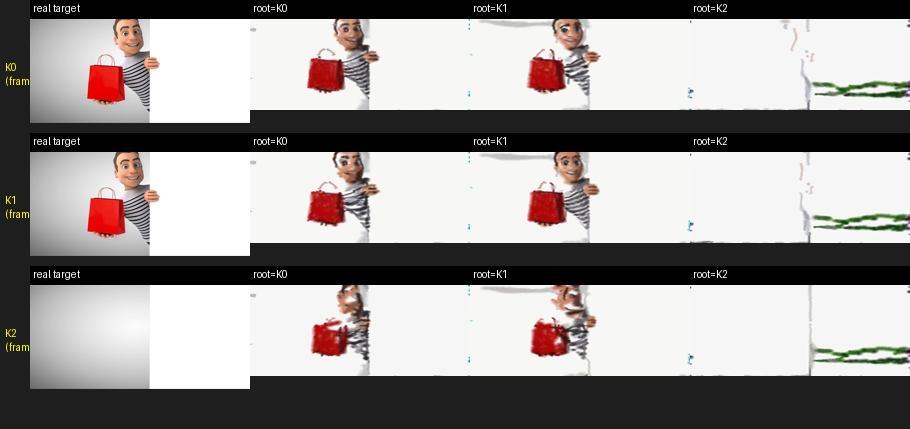
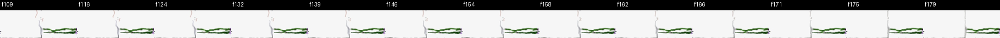
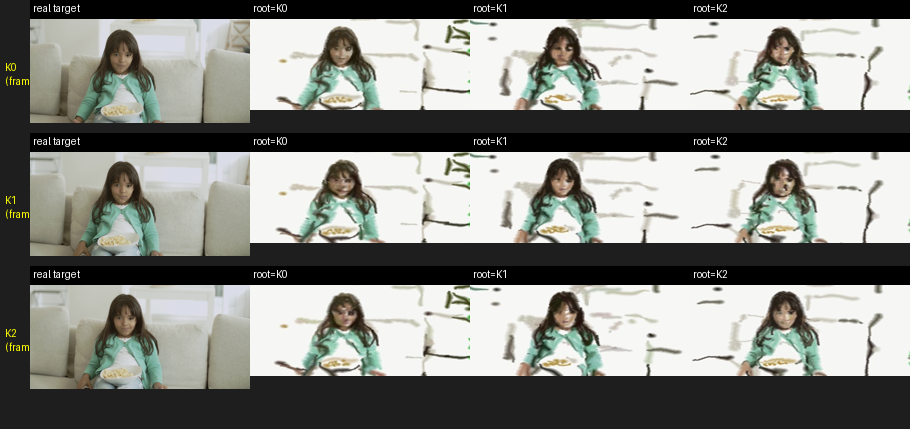

# Three-keyframe chained-correspondence experiment

Extends the two-keyframe chained-correspondence experiment
(`FRIDAAnimation/src/keyframing/tests/chained_keyframe_experiment.py`) to three
keyframes, to test root selection and chain-depth drift. Script:
`FRIDAAnimation/src/keyframing/tests/chained_three_keyframe_experiment.py`.

**Not a pipeline change** — standalone experiment script. Does not modify
`stroke_propagator.py`, `stroke_refiner.py`, `stroke_planner.py`,
`keyframe_selector.py`, `losses.py`, or `config.py`, and never touches optical
flow.

## What this tests

With three keyframes K0 < K1 < K2 in time, each keyframe is optimized exactly
once. One is the **root** (optimized freely against its real target frame, no
constraint); the other two chain outward from it, adjacency-only — each
non-root keyframe initializes from its parent's converged strokes (index `i`
in the parent = index `i` in the child, by construction) and is optimized with
a correspondence penalty (position heaviest, color heavy, shape moderate)
pulling it toward that parent, on top of the usual `clip_conv_loss_masked`
objective against its own real target frame. Three configurations per video
clip:

```
root=K0: K0 -> K1 -> K2   (K2 is chain-depth 2 from the root)
root=K1: K0 <- K1 -> K2   (bidirectional, chain-depth 1 each way)
root=K2: K0 <- K1 <- K2   (K0 is chain-depth 2 from the root)
```

Inbetweens between adjacent keyframe pairs are produced by pure per-parameter
linear interpolation — no optical flow, no `StrokePropagator`, no
`StrokeRefiner`, no smoothing, no per-frame optimization.

Same stroke count (150), same correspondence weights, same iteration count
(800) across all three root configs and both test clips — root choice is the
only thing varying between runs of the same clip.

## Clips tested

| Clip | Frames | Res | fps | Keyframes picked | Interval classes | mean_motion |
|---|---|---|---|---|---|---|
| `test2.mp4` | 180 | 480×852 | 30 | 109, 154, 179 | subtle_persistent_motion, semantic_transition | 0.005, 0.158 |
| `popcorn.mp4` | 215 | 2160×3840 | 25 | 123, 165, 173 | subtle_persistent_motion, high_action | 0.237, 0.748 |

Keyframes were chosen automatically by `select_three_keyframes`: the pair of
adjacent intervals with the highest combined `mean_motion` among all
non-STABLE pairs in the plan (STABLE intervals excluded — they'd pass the
correspondence test trivially).

## Results

### test2.mp4

| Config | K0 (109) | K1 (154) | K2 (179) |
|---|---|---|---|
| root=K0 | **ROOT**, loss=0.225, Q_t=0.333 | depth-1, loss=0.314, Q_t=0.302 | depth-2, loss=0.649, Q_t=0.825 |
| root=K1 | depth-1, loss=0.301, Q_t=0.333 | **ROOT**, loss=0.225, Q_t=0.302 | depth-1, loss=0.664, Q_t=0.825 |
| root=K2 | depth-2, loss=0.753, Q_t=0.333 | depth-1, loss=0.756, Q_t=0.302 | **ROOT**, loss=0.497, Q_t=0.625 |

Per-edge drift (mean position drift / mean color drift, normalized [0,1]
canvas / RGB units):

| Config | Edge | Position drift | Color drift |
|---|---|---|---|
| root=K0 | K0→K1 | 0.00672 | 0.01219 |
| root=K0 | K1→K2 | 0.01221 | 0.01338 |
| root=K1 | K1→K0 | 0.00637 | 0.01328 |
| root=K1 | K1→K2 | 0.01201 | 0.01396 |
| root=K2 | K2→K1 | 0.00597 | 0.01255 |
| root=K2 | K1→K0 | 0.00591 | 0.01185 |

**Pattern:** K2 (frame 179, the highest-Q_t keyframe at 0.825) has by far the
worst fitting loss whenever it isn't the root (0.649–0.664, vs. 0.497 as
root). root=K2 also drags K0 to its worst loss across all nine
config×keyframe combinations (0.753). Drift magnitudes themselves stay in a
narrow band regardless of root choice — the loss penalty from chaining shows
up much more in fitting loss than in raw per-stroke drift.



Full rendered sequences (keyframes + pure-interpolation inbetweens, in
temporal order):

root=K0:


root=K1:


root=K2:


### popcorn.mp4

| Config | K0 (123) | K1 (165) | K2 (173) |
|---|---|---|---|
| root=K0 | **ROOT**, loss=0.304, Q_t=0.583 | depth-1, loss=0.385, Q_t=0.708 | depth-2, loss=0.383, Q_t=0.625 |
| root=K1 | depth-1, loss=0.405, Q_t=0.583 | **ROOT**, loss=0.266, Q_t=0.708 | depth-1, loss=0.338, Q_t=0.625 |
| root=K2 | depth-2, loss=0.410, Q_t=0.583 | depth-1, loss=0.392, Q_t=0.708 | **ROOT**, loss=0.305, Q_t=0.625 |

Per-edge drift:

| Config | Edge | Position drift | Color drift |
|---|---|---|---|
| root=K0 | K0→K1 | 0.00954 | 0.01572 |
| root=K0 | K1→K2 | 0.01102 | 0.01409 |
| root=K1 | K1→K0 | 0.01140 | 0.01542 |
| root=K1 | K1→K2 | 0.01257 | 0.01559 |
| root=K2 | K2→K1 | 0.01241 | 0.01586 |
| root=K2 | K1→K0 | 0.01139 | 0.01587 |

**Pattern:** unlike test2.mp4, root=K1 gives the lowest loss for *every*
keyframe simultaneously (0.405 / 0.266 / 0.338, each ≤ its loss in the other
two configs) — on this clip root=K1 dominates outright, whereas on test2.mp4
the depth-2 keyframe was clearly the weak point regardless of which root was
chosen. Color drift is uniformly higher here than on test2.mp4 (~0.0141–0.0159
vs. ~0.0119–0.0140), roughly flat across depth-1 and depth-2 edges — no
obvious cliff at chain-depth 2 on this clip.



Full rendered sequences:

root=K0:


root=K1:


root=K2:


## Real-time playback videos

Each root config's rendered sequence was also stitched into an mp4 that holds
each frame for the real elapsed-time gap between its underlying source-video
frame index and the next one (at the clip's real fps — 30 for test2.mp4, 25
for popcorn.mp4), so it plays back at the same speed as the original footage
rather than with evenly-spaced frames:

- `realtime_videos/test2_rootK0.mp4`, `test2_rootK1.mp4`, `test2_rootK2.mp4` (2.47 s each, source frames 109–179)
- `realtime_videos/popcorn_rootK0.mp4`, `popcorn_rootK1.mp4`, `popcorn_rootK2.mp4` (2.04 s each, source frames 123–173)

## Raw output directories

All rendered + real target frames, full console logs with per-iteration loss
printouts:

- `FRIDAAnimation/src/keyframing/tests/chained_three_keyframe_experiment_109_154_179_rootK{0,1,2}/`
- `FRIDAAnimation/src/keyframing/tests/chained_three_keyframe_experiment_123_165_173_rootK{0,1,2}/`

## Open questions (surfaced, not solved by this experiment)

- **Multiple roots would reintroduce the uncorrelated-stroke-basis seam this
  whole approach exists to eliminate** — two independently-optimized anchors
  mean stroke index `i` means two different things on either side of wherever
  their chains meet. This experiment deliberately tests single-root only.
- **Fixed stroke count conflicts with `StrokePlanner`'s class-based
  per-interval budgets** (`HIGH_ACTION` gets more strokes than `STABLE` in the
  real pipeline). Sidestepped here by fixing the count (150) across all three
  keyframes so index `i` has a stable meaning to interpolate; not resolved.
- No interpretation is offered here of whether the rendered frames "look
  good" visually — the numbers above (loss, drift, Q_t) are reported as-is
  for visual judgment against the linked images and videos.
